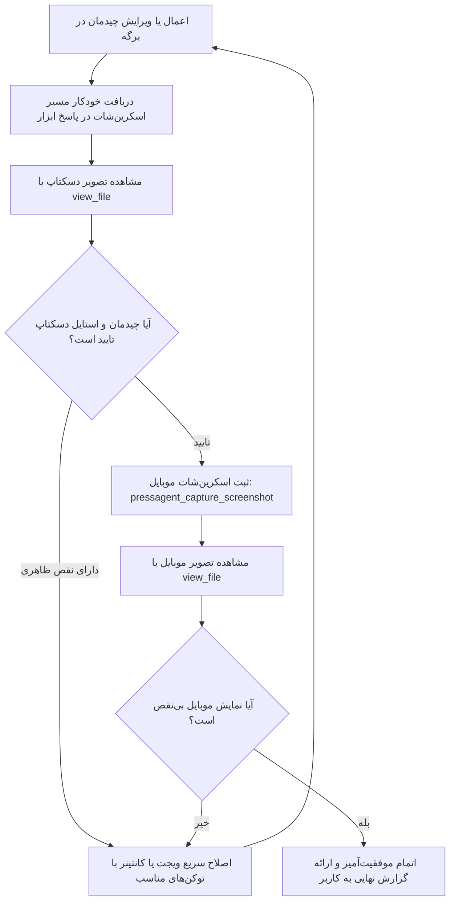

# بازرسی بصری و تضمین کیفیت طراحی در المنتور (Visual QA)

سرور PressAgent به طور خودکار پس از هر عملیات ذخیره یا به‌روزرسانی برگه، کش را پاکسازی کرده و اسکرین‌شات دسکتاپ را در پاسخ ابزار تحویل می‌دهد. این مهارت چرخه **تحلیل چندوجهی (Multimodal) تصویر و ارتقای کیفیت بصری** را هدایت می‌کند.

---

## ۱. چرخه بازخورد بصری خودکار



---

## ۲. چک‌لیست تحلیل تصویر (Eye QA Checklist)

ابزار `view_file` را بر روی فایل تصویر بازگردانده شده فراخوانی کنید:
```text
view_file({ "AbsolutePath": result.screenshot.image_path })
```

تصویر لود شده را در کانتکست بصری بررسی نمایید:
- [ ] **چینش و تراز افقی:** آیا کارت‌ها و دکمه‌ها در ردیف‌های متوازن قرار دارند یا ناخواسته زیر هم انباشته شده‌اند؟
- [ ] **تراز و راست‌چین بودن (RTL):** آیا چیدمان زبان فارسی، آیکون‌ها و نقاط شروع متون به درستی در سمت راست قرار دارند؟
- [ ] **خوانایی و کنتراست رنگی:** آیا متن‌ها روی رنگ‌های پس‌زمینه به وضوح خوانده می‌شوند؟
- [ ] **عدم همپوشانی و شکستگی:** آیا متنی بریده شده یا روی دکمه/تصویر مجاور افتاده است؟

---

## ۳. بررسی نمایش موبایل (Mobile Inspection)

برای اطمینان از واکنش‌گرایی (Responsive):
```json
pressagent_capture_screenshot({
  "page_id": <PAGE_ID>,
  "viewport": "mobile"
})
```
سپس فایل تصویر موبایل را با `view_file` بررسی کنید تا از عدم وجود اسکرول افقی ناخواسته و تناسب ابعاد لمسی مطمئن شوید.
