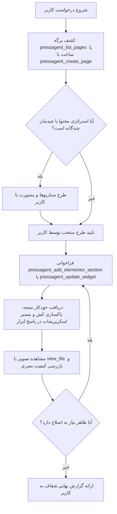

# مهارت طراحی و مدیریت برگه‌های المنتور با PressAgent MCP

سرور PressAgent به صورت خودکار قوانین ساختاری، یکتایی شناسه‌ها، اعتبارسنجی مقادیر ابعادی، حل توکن‌های طراحی بر اساس کیت فعال سایت، تطهیر کش و ثبت اسکرین‌شات بصری را مدیریت می‌کند.

این مهارت شما را در **تصمیم‌گیری‌های خلاقانه، مشورت با کاربر و حلقه بازرسی بصری خروجی** هدایت می‌کند.

---

## ۱. گردش‌کار یکپارچه (Integrated Workflow)

---

## ۲. گیت تصمیم‌گیری و مشورت با کاربر (Interactive Gate)

در این شرایط **حتماً قبل از اعمال تغییرات با کاربر مشورت کنید**:
- **تنوع در چیدمان (Layout Options):** اگر چیدمان می‌تواند به صورت شبکه کارت‌های ۳تایی باشد یا اسلایدر، گزینه‌ها را به کاربر پیشنهاد دهید.
- **ابهام در کپی‌رایتینگ و اطلاعات کسب‌وکار:** اگر تخفیف، قیمت، اطلاعات تماس یا خدمات نیاز به تایید کارفرما دارد.
- **تغییرات بزرگ ساختاری:** پیش از بازطراحی کامل برگه با `replace_all: true`، رضایت کاربر را جلب نمایید.

---

## ۳. بازرسی بصری هوشمند خروجی (Visual Inspection Loop)

پس از هر بار فراخوانی ابزارهای ساخت یا به‌روزرسانی بخش‌های برگه (`pressagent_add_elementor_section`، `pressagent_update_widget` یا `pressagent_create_page`):
1. ابزار به صورت خودکار تصویر پیش‌نمایش برگه را در فیلد `screenshot.image_path` بازمی‌گرداند.
2. با ابزار `view_file` تصویر را بررسی کنید:
   - آیا تناسب و تعادل بصری در زبان فارسی (RTL) رعایت شده است؟
   - آیا فاصله‌ها و حاشیه‌ها چشم‌نواز و استاندارد هستند؟
   - آیا تضاد رنگی متن‌ها با پس‌زمینه خوانا و ارگونومیک است؟
3. در صورت نیاز به رتوش جزئی، با یک فراخوانی سریع `pressagent_update_widget` یا تنظیم مجدد کانتینر، طراحی را به کمال برسانید.
